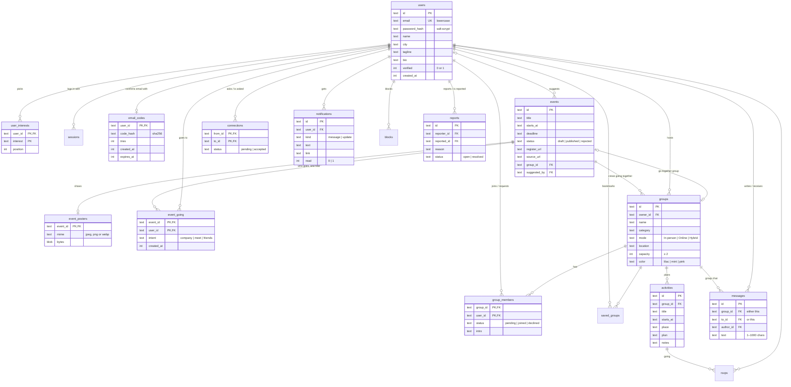

# Comoonly data model

## Where the data lives

Everything (accounts, profiles, groups, chats, events, notifications) is stored in **one SQLite
database file**, managed by the Node.js server through Node's built-in `node:sqlite`.

| Where | File | Notes |
|---|---|---|
| Your computer | `server/data/comoonly.db` | Created on first start. Not in Git. Delete it to start fresh. |
| Production | `DB_PATH` (e.g. `/var/data/comoonly.db`) | Must be on the host's **persistent disk**, or data is lost on each deploy. Back up by copying the file. |
| Tests | in memory | Every test file gets a fresh database with sample data. |

The browser never talks to the database. It only calls the API (`/api/...`); the server checks who you
are and what you're allowed to see before reading or writing anything. Passwords are stored only as
salted scrypt hashes. The browser holds just one secret: a session cookie that page scripts can't read.

## Diagram

Not drawn, to keep it readable: `sessions`, `saved_groups`, `rsvps`, `blocks` (simple two-key link
tables) and `seen_posts` (Instagram post ids the reader already checked).

## Design decisions

**Membership and join requests are one table.** A request is a `group_members` row with status
`pending`; the host flips it to `joined` or `declined`. There's no second table to keep in sync, member
counts are a single `COUNT(... WHERE status = 'joined')`, and declined rows stay, so the same person can't
keep re-sending requests.

**Open spots are calculated, not stored.** `groups.capacity` is stored; "spots left" is
`capacity − joined members`. A stored counter could drift out of date; a calculation can't.

**Group chat and private messages share one table.** Exactly one of `group_id` / `to_id` is set,
enforced by a `CHECK`. One table means one way to send, list, notify and moderate messages.

**Interests are rows, not a text list.** `user_interests` has one row per interest, so "who likes
Hackathons?" is an indexed lookup. That's what powers event alerts. `position` keeps the order people
picked them in.

**One connection per pair.** A unique index on `(min(from_id, to_id), max(from_id, to_id))` makes
"A→B" and "B→A" the same pair at the database level, not just in code.

**The database guards its own rules.** Allowed values (`status`, `mode`, `color`, `kind`), "not
yourself" (connections, blocks, reports), lowercase emails and message length are `CHECK` constraints;
links between tables are foreign keys with `PRAGMA foreign_keys = ON`. `server/test/database.test.ts`
proves invalid data is rejected even if server code had a bug.

**Deleting is deliberate.** `ON DELETE CASCADE` removes things that only make sense with their parent
(a group's chat and activities). `ON DELETE SET NULL` keeps history: an event stays when the
person who suggested it leaves, and an activity stays when its creator does.

**Times have one format each.** Moments the server records (`created_at`, `expires_at`) are integers in
milliseconds: easy to compare and sort. Dates people type (`starts_at`, `deadline`) are ISO text such as
`2026-11-02T18:00`, kept as typed in local time (Pakistan), and they sort correctly as text.

**Indexes match the screens.** Every common lookup has one: the feed (`groups(location, category)`),
"my groups" (`group_members(user_id, status)`), a chat (`messages(group_id, created_at)`), the Events
page (`events(status, starts_at)`), the notification badge (`notifications(user_id, read, created_at)`).

**Changes are versioned.** The schema lives in numbered files in `server/src/db/migrations/`. SQLite's
`user_version` records which have run, so a deployed database picks up exactly the new ones on start.
To change the database: add `002_what-changed.sql`; never edit a migration that has shipped.

**Validation happens twice, on purpose.** Zod checks every request at the API boundary and returns a
friendly message; the database constraints are the last line of defence.

## What each table holds

| Table | One row is… | Removed when |
|---|---|---|
| `users` | a person | they're deleted (cascades to almost everything they own) |
| `user_interests` | one interest of one person | profile is re-saved / person deleted |
| `event_going` | one person going to one event, and how (looking for company, happy to meet, with friends) | they're not going any more / event deleted |
| `event_posters` | an event's poster picture | event deleted / poster replaced |
| `sessions` | one logged-in browser | logout, expiry, person deleted |
| `email_codes` | the 6-digit sign-up code waiting to be entered (hashed) | entered, replaced by a new one, person deleted |
| `connections` | a request or friendship between two people | declined, blocked, person deleted |
| `groups` | a small group, an event's "everyone going" group, or a crew (`event_id` set; `women_only` kept by a trigger) | host deleted |
| `group_members` | someone in, waiting for, or declined from a group | they leave / cancel |
| `saved_groups` | a bookmark | un-saved |
| `activities` / `rsvps` | a plan in a group / someone going to it | group deleted / un-RSVP |
| `messages` | one chat message (group or private) | group or either person deleted |
| `notifications` | one notice for one person | read and older than 60 days |
| `events` | a found, suggested or added event | drafts: when the date or deadline passes; rejected: after 30 days; published: kept |
| `seen_posts` | an Instagram post already checked | after 30 days |
| `blocks` / `reports` | a block / a report | unblock / never (resolved reports are kept) |
